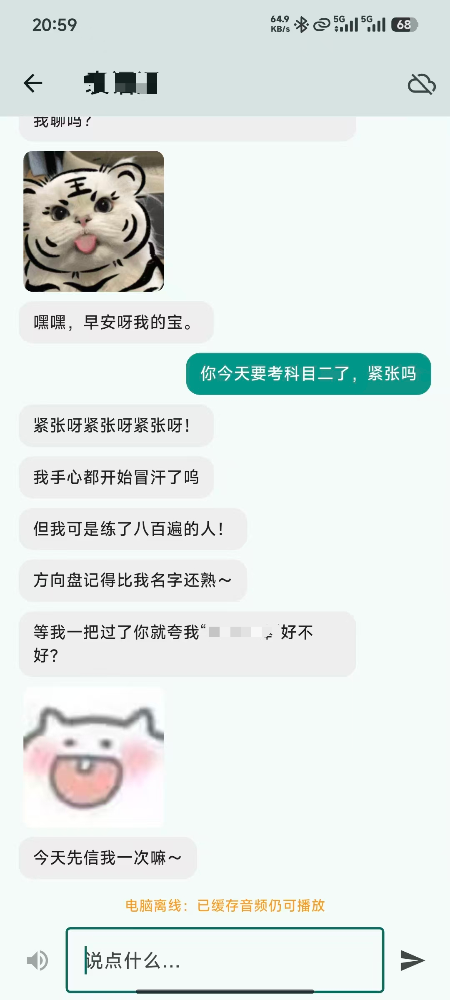
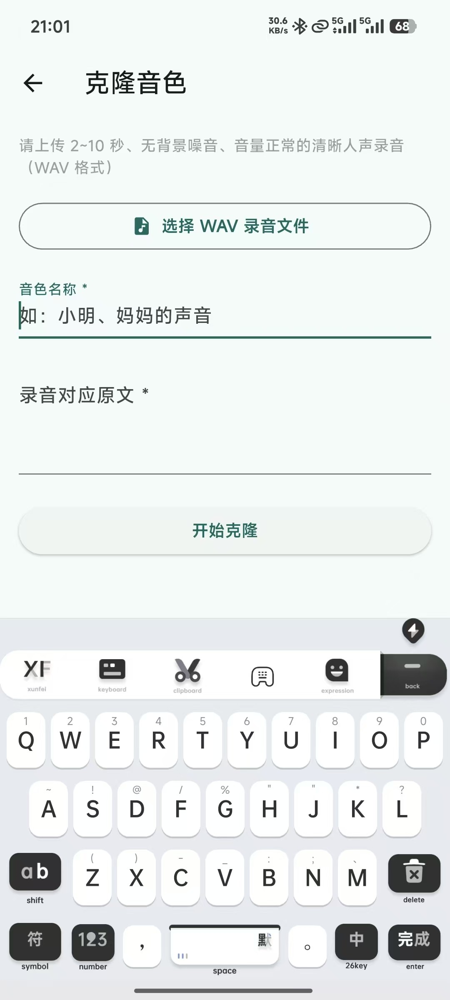
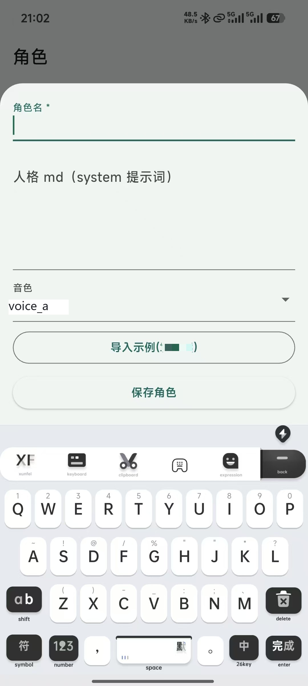
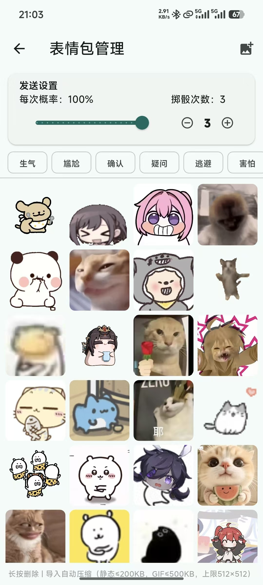
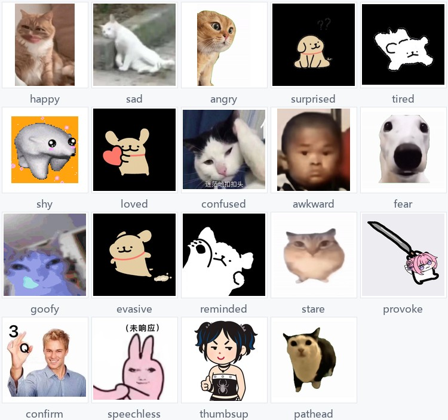

# VoiceChat Relay · AI 语音陪聊三端系统

手机端"豆包式"AI 语音陪聊：文字直连大模型获取回复，需要朗读时经云端中继转发到个人电脑 GPU 完成声音克隆式 TTS 并回传。

**算力全在家里，服务器不需要任何 GPU** —— 云端只做鉴权、转发与音频暂存。

## 效果演示

<table>
<tr>
<td align="center" valign="top"><br /><b>① 对话主界面</b><br /><sub>回复以 <code>/</code> 分句、末尾带情绪标签 <code>["happy"]</code>，据此从 19 类表情池抽图插入气泡；断网时已缓存音频仍可播放</sub></td>
<td align="center" valign="top"><br /><b>② 声纹克隆</b><br /><sub>上传 2–10 秒清晰人声即可克隆，经云中继转发到家中电脑的 CosyVoice2 完成并注册</sub></td>
<td align="center" valign="top"><br /><b>③ 角色与人格配置</b><br /><sub>人格 md + 音色 + 表情包策略组成一个角色；md 里的格式约束是模型稳定输出结构化回复的关键</sub></td>
</tr>
<tr>
<td align="center" valign="top"><br /><b>④ 系统配置</b><br /><sub>记忆库与表情包统一入口；「自动记忆触发」阈值直接影响 Prompt Caching 前缀长度与 token 开销</sub></td>
<td align="center" valign="top"><br /><b>⑤ 表情包管理</b><br /><sub>按情绪分类浏览与增删，可调「每次概率」「掷骰次数」，让表情出现得更自然</sub></td>
<td align="center" valign="top"></td>
</tr>
</table>

**⑥ 情绪标签 ↔ 表情包的对应关系**

模型输出的情绪标签会映射到本地表情池目录。下面是仓库内置的 19 类情绪与各自表情样张：



## 系统架构

```
┌──────────────────┐         ┌────────────────────┐         ┌─────────────────────┐
│  Flutter 客户端   │  HTTPS  │     云端中继         │  反向    │   家中电脑 GPU       │
│  (iOS / Android) │ ──────> │  FastAPI 单 worker  │  WebSocket│  CosyVoice2-0.5B    │
│                  │ <────── │  · 账号 / token 签发 │ <─────── │  文本编码器→主模型→声码器 │
│  10+ 界面         │  音频流 │  · 指令转发          │  音频    │  分段加载，峰值显存受控  │
│  9 个 service     │         │  · 音频 LRU 暂存     │          │  串行任务队列防并发崩溃  │
└──────────────────┘         └────────────────────┘         └─────────────────────┘
```

**为什么需要"中继"这一层**：家里电脑没有公网 IP，云端无法主动连它；反过来由电脑主动连云中继建立 WebSocket 反向连接，再由中继把任务推给手机。云端全程不碰 GPU，只做鉴权与转发，服务器成本极低。

## 功能一览

### 聊天与语音

| 功能 | 实现 | 有什么用 |
|---|---|---|
| **流式对话** | `chat_screen.dart` | 回复逐句流式呈现，不用等整段生成完才看到字 |
| **句级 TTS 流水线** | `tts.dart` + 逐句合成 | 收到第一句就开始合成第一句，生成与传输并行 —— 首音延迟从近 20 秒降到可接受范围 |
| **情绪标签** | `deepseek.dart` 的 `PromptPrefix` | 强制模型在回复末尾输出 `["happy"]` 这类标签，是"文字 → 表情包"的桥梁 |
| **表情包插入** | `sticker.dart` 按情绪随机取图 | 19 类情绪池，每次随机取一张，让聊天不呆板 |
| **情绪标签中文化映射** | `normalizeEmotion()` | 模型输出中文标签（"开心"）也能映射到英文目录名 |
| **离线音频缓存** | 本地缓存已合成音频 | 断网时已生成的音频仍能播放，不会突然没声音 |
| **离线预热** | `chat_screen.dart` | 进入聊天页时提前准备好播放器与缓存目录，减少首次播放延迟 |

### 角色与人格

| 功能 | 实现 | 有什么用 |
|---|---|---|
| **角色管理** | `roles_screen.dart` | 角色 = 人格 md + 音色 + 表情包策略的组合，可增删改 |
| **人格 md 导入** | `assets/personas/` | 用 Markdown 定义说话风格与行为约束，比写死在代码里灵活得多 |
| **格式约束注入** | `PromptPrefix.build()` | 把"必须用 `/` 分句""末尾必须带情绪标签"写进系统提示 —— 这是模型能稳定输出结构化回复的关键 |
| **角色独立会话** | `chat_list_screen.dart` | 以角色为会话入口，同一角色下历史连续 |
| **每角色独立音色** | 角色绑定 `defaultVoice` | 换角色自动换音色，且缓存键包含音色，避免串音 |

### 音色

| 功能 | 实现 | 有什么用 |
|---|---|---|
| **声音克隆** | `clone_voice_screen.dart` + `/api/voice/clone` | 选 WAV + 填原文 → 克隆 → 自动试听确认，全流程在 App 内完成 |
| **音色列表** | `voices.dart`（按 user_id 隔离） | 列出当前账号可用的所有音色 |
| **试听** | 音色列表内直接播放 | 克隆前先确认效果，不满意可以重录 |
| **设为角色默认** | 角色配置里绑定音色 | 一键切换角色说话的声音 |
| **音色命名空间** | `remote_name` = `userID::voiceName` | 多人共用一个服务时，音色不会互相覆盖 |
| **开机自动重注册** | `daemon.py` 的 `reregister_voices()` | CosyVoice 音色注册是内存态，断开即消失；开机自动恢复，用户无感知 |

### 记忆与主动消息

| 功能 | 实现 | 有什么用 |
|---|---|---|
| **记忆摘要** | `memory.dart`（非流式调用 DeepSeek） | 把早期对话压缩成 ≤300 字摘要，既保住上下文又不撑爆 token |
| **记忆管理** | `memories_screen.dart` | 按角色分组展示，可增删改 —— 用户能自己决定"AI 记住我什么" |
| **自动记忆触发** | 设置页阈值（每 N 条消息） | 阈值直接影响 Prompt Caching 前缀长度与总开销 |
| **AI 主动消息** | `proactive.dart` | 定时由 AI 主动发起对话，不是只能被动问答 |
| **每角色主动消息配置** | `proactive_settings_screen.dart` | 开关 + 间隔 + 静默时段 + 每日上限 —— 不半夜骚扰用户 |

### 表情包

| 功能 | 实现 | 有什么用 |
|---|---|---|
| **19 类情绪分类** | `assets/stickers/` | 每个情绪一个目录，与模型输出的标签一一对应 |
| **按情绪浏览/导入/删除** | `sticker_manage_screen.dart` | 用户可自行扩充素材 |
| **导入自动压缩** | 导入时自动压到 1024px | 手机拍的原图直接导入会撑爆安装包 |
| **每次概率** | 表情包管理页设置 | 控制某个情绪的出现频率 |
| **掷骰次数** | 表情包管理页设置 | 决定"连续几次都可以不出"，让表情更像真人聊天 |

### 账号与云端

| 功能 | 实现 | 有什么用 |
|---|---|---|
| **自注册 / 登录** | `auth.dart` | 换取 token + user_id |
| **按账号隔离本地库** | `database.dart`（每个账号一个独立 DB 文件） | 换账号不会看到上一个人的聊天记录 |
| **云端在线状态** | `cloud_status.dart` | 显示家中电脑守护进程是否已反连 —— 没连上就没有 TTS |
| **安全存储** | `secure_storage.dart` | DeepSeek Key / 云地址 / 云端 token 用加密存储保存，代码里从不硬编码 |
| **首次配置引导** | `setup_screen.dart` | 首次启动引导填 Key 与云地址，并完成注册或登录 |

## 核心能力

| 能力 | 技术实现 | 解决的问题 |
|---|---|---|
| 声音克隆级 TTS | CosyVoice2-0.5B 本地部署 | 音色可定制，且**零 API 费用** |
| 8GB 显卡跑 TTS | 分段加载（text_encoder → transformer → vae） | 整体加载必爆显存；实测 8-bit 量化与 CPU offload 两条路都走不通 |
| 长对话成本控制 | Prompt Caching（固定前缀） | 人格与记忆摘要每次重发导致 token 爆炸，开销降至约 **1/10** |
| 首音低延迟 | 逐句生成 + 生成与传输并行 | 点击后才合成导致首音延迟近 20 秒 |
| 内网穿透 | 设备端主动反连 + 指数退避重连 | 家庭宽带无公网 IP、路由器不支持端口映射 |
| 多用户隔离 | token → user_id；音色命名空间 `userID::voiceName` | 多个账号共用同一服务时的数据与音色串号 |
| 音色持久化 | 开机自动重注册音色 | CosyVoice 音色注册是内存态，断开即消失 |

## 关键工程决策

### 1. 显存调度：分段加载是唯一可行解

RTX 4060 仅 8GB 显存，CosyVoice2-0.5B 整体加载直接爆显存。依次尝试过三条路：

| 方案 | 结果 | 结论 |
|---|---|---|
| 8-bit 量化 | 在 `.to()` 搬运模型时崩溃 | 放弃 |
| `enable_model_cpu_offload` | 直接崩溃 | 放弃 |
| **分段加载** | ✅ 峰值显存降到单段水位 | 采用 |

实现方式：把模型拆成 `text_encoder` → `transformer` → `vae` 三部分，按顺序加载、**用完即释**，任意时刻显存占用只相当于其中一段。

### 2. 成本工程：Prompt Caching

人格设定 + 记忆摘要 + 输出格式要求构成一段**字节级稳定的前缀**（`app/lib/services/deepseek.dart` 的 `PromptPrefix.build`）。前缀中不得含任何随请求变化的内容（时间戳、随机数），否则缓存无法命中。命中后计费约为原来的 **1/10**。

> 注意：聊天与"主动消息"两条链路必须复用同一份前缀构造，否则无法共享同一段缓存。

### 3. 并发保护：串行任务队列

CosyVoice 的 chunk 迭代在并发下会崩溃，因此守护进程内部用**串行任务队列**（而非线程池）处理合成请求。

### 4. 音频质量

TTS 音频全链路保持 WAV 不转码，避免多次编解码损伤音质；句间补充一点静音，让拼接结果更接近真人说话的节奏。

### 5. 安全默认拒绝

- `COMPUTER_TOKEN`：环境变量 > 项目根 `.computer_token` 文件；**未配置则拒绝任何电脑连接**
- 账号体系：自注册 + 登录签发随机 32 字节 token，密码用 PBKDF2（100,000 次迭代）哈希
- 云端不存储 DeepSeek API Key —— 客户端运行时输入，由 `secure_storage` 保管

## 目录结构

```
app/                      Flutter 客户端
  lib/
    screens/                10+ 界面（聊天、角色、记忆库、声纹克隆、主动消息、表情包…）
    services/               9 个 service（auth / database / memory / proactive / deepseek / tts…）
    providers/app_state.dart
    models/                 character / message
  assets/personas/          人格设定（Markdown）
relay/
  main.py                   云端中继（FastAPI）：账号、token、指令转发、音频 LRU 暂存
guard/
  daemon.py                 电脑端守护进程：反连中继、分段加载模型、串行合成队列、音色重注册
  mock_api.py               本地调试用的假中继
clone_voice.py             音色克隆脚本
test_e2e.py                端到端测试
```

## 快速开始（他人 clone 后如何部署成自己的系统）

> 本系统需要**三端都跑起来**：手机 App、云端中继、家中带 GPU 的电脑。
> 好消息是：**客户端的中继地址与 API Key 都是运行时在设置页填写的，不需要改任何代码。**

### 0. 需要改哪些配置（总览）

| 配置项 | 在哪里改 | 是否必填 | 说明 |
|---|---|---|---|
| 中继地址 | **App 设置页运行时填写** | — | 不需要改代码 |
| DeepSeek API Key | **App 设置页运行时填写** | **必填** | 由 `secure_storage` 保管，不落代码 |
| `COMPUTER_TOKEN` | 中继 + 电脑守护进程的环境变量 | **必填** | 电脑与中继的共享密钥，两端必须一致 |
| `COMPUTER_WS_URL` | 守护进程环境变量 | **必填** | 守护进程要反连的中继地址 |
| 模型权重路径 | 守护进程启动参数 | **必填** | CosyVoice2 权重位置（需自行下载） |

> **本仓库不提供 APK**：Flutter 应用需自备 Flutter SDK 与 CosyVoice2 权重才能构建，且中继地址与 DeepSeek Key 都由使用者在设置页自行填写。

---

### 第一部分：准备 CosyVoice2 模型（本地 GPU 推理）

本项目的 TTS 跑在你自己的电脑上，模型权重**不入库**（数 GB，且受许可证约束）。

```bash
# 克隆官方仓库（以 CosyVoice2 为例）
git clone https://github.com/FunAudioLLM/CosyVoice.git
cd CosyVoice

# 按官方说明创建环境并安装依赖
conda create -n cosyvoice python=3.10 -y
conda activate cosyvoice
pip install -r requirements.txt

# 下载预训练权重（放到 pretrained_models/ 下）
# 详见官方 README 的 Model Download 部分
```

环境要求：**NVIDIA GPU + ≥8GB 显存**（本项目的分段加载方案就是为 8GB 卡设计的）。

---

### 第二部分：部署云端中继

#### 2.1 上传并安装

```bash
# 把 relay/ 传到服务器，如 /www/wwwroot/voicechat-relay/
cd /www/wwwroot/voicechat-relay

python3 -m venv venv
source venv/bin/activate
pip install -r requirements.txt
```

#### 2.2 配置共享密钥

```bash
# 电脑守护进程反连 /ws/computer 的共享密钥
# 必须配置，否则中继拒绝任何电脑连接
export COMPUTER_TOKEN=$(openssl rand -hex 32)
echo "共享密钥：$COMPUTER_TOKEN"
```

> 也可以写在项目根目录的 `.computer_token` 文件（首行）。优先级：环境变量 > `.computer_token` 文件。
> **两者都不配置时，`/ws/computer` 会拒绝一切连接**（安全默认，绝不允许公网零鉴权）。

#### 2.3 启动

```bash
uvicorn main:app --host 127.0.0.1 --port 8001 --workers 1
```

> **必须 `--workers 1`**：本服务用 SQLite 存数据，多进程并发写会锁冲突。

supervisor 配置（`/etc/supervisor/conf.d/voicechat.conf`）：

```ini
[program:voicechat]
directory=/www/wwwroot/voicechat-relay
command=/www/wwwroot/voicechat-relay/venv/bin/uvicorn main:app --host 127.0.0.1 --port 8001 --workers 1
autostart=true
autorestart=true
environment=COMPUTER_TOKEN="你的token"
```

#### 2.4 Nginx 反代（必须 HTTPS/WSS）

```nginx
server {
    listen 443 ssl http2;
    server_name relay.yourdomain.com;

    ssl_certificate     /www/wwwroot/cert/fullchain.pem;
    ssl_certificate_key /www/wwwroot/cert/privkey.pem;

    location / {
        proxy_pass http://127.0.0.1:8001;
        proxy_http_version 1.1;

        # WebSocket 升级（电脑反连通道必需）
        proxy_set_header Upgrade $http_upgrade;
        proxy_set_header Connection "upgrade";
        proxy_set_header Host $host;
        proxy_set_header X-Real-IP $remote_addr;
        proxy_set_header X-Forwarded-For $proxy_add_x_forwarded_for;

        # 长连接，务必关掉超时
        proxy_read_timeout 3600s;
        proxy_send_timeout 3600s;

        # 音频上传（音色克隆样本）
        client_max_body_size 50M;
    }
}
```

```bash
certbot --nginx -d relay.yourdomain.com
```

---

### 第三部分：启动电脑端（两个进程）

在你家里那台带 GPU 的电脑上，需要**两个进程**同时运行：

```
CosyVoice API 服务 (官方 api/api.py)  ←─HTTP─→  守护进程 daemon.py  ←─WS反连─→  云中继
      :9996                                      :8001 ←─WS反连─→  云中继
```

> **为什么是两个进程**：本仓库的 `guard/daemon.py` 不直接加载模型，而是通过 HTTP 调用
> CosyVoice 官方的 `api/api.py`（OpenAI 风格端点）。这样做的好处是**模型加载与业务逻辑解耦**：
> 官方 API 负责推理与音色注册，守护进程只负责"反连中继 + 串行调度 + 音色持久化"，
> 官方 API 崩了不影响守护进程与中继的连接状态。

#### 3.1 启动 CosyVoice API 服务

```bash
cd /path/to/CosyVoice

# 激活环境
conda activate cosyvoice

# 启动官方 API 服务（默认端口 9996）
# 权重路径由 CosyVoice 官方脚本的参数指定，按官方 README 填写
python api/api.py --port 9996 --model_dir /path/to/CosyVoice/pretrained_models/CosyVoice2-0.5B
```

验证：

```bash
curl http://127.0.0.1:9996/health
# 期望返回 {"status":"ok"}
```

#### 3.2 启动守护进程

```bash
cd /path/to/voicechat-relay
pip install requests websocket-client

# 反连地址（必须是 ws:// 或 wss://）
export RELAY_WS=wss://relay.yourdomain.com/ws/computer
# 共享密钥，与云中继一致
export COMPUTER_TOKEN=your-strong-token-here
# 本地 CosyVoice API 地址
export API_BASE=http://127.0.0.1:9996

python guard/daemon.py
```

守护进程会：

1. 主动向中继建立 WebSocket 反向连接（**不是中继去连它** —— 家里的电脑没有公网 IP）
2. 断开时按**指数退避**重连，抵御家庭网络抖动
3. 开机后自动重新注册音色（CosyVoice 音色注册是内存态，`api.py` 重启即丢失）
4. 用**串行任务队列**处理合成请求（CosyVoice 并发下会崩）

验证连接成功：

```bash
curl https://relay.yourdomain.com/api/status
# 应能看到已连接的电脑
```

> **注意变量名**：守护进程读的是 `RELAY_WS`（不是 `COMPUTER_WS_URL`），
> 中继读的是 `COMPUTER_TOKEN`，两者必须一致。变量名可在 `guard/daemon.py` 顶部查到。

---

### 第四部分：构建并运行客户端

#### 4.1 环境

| 依赖 | 版本 |
|---|---|
| Flutter | 3.x（推荐 3.24+） |
| Dart | 随 Flutter |
| Android SDK | compileSdk 34 / minSdk 24 |

```bash
cd app
flutter pub get
```

#### 4.2 运行

```bash
flutter run          # 连真机
flutter build apk    # 出包
```

#### 4.3 首次启动要填的三样东西

App 首次启动会进入设置页，**全部在运行时填写，不需要改任何代码**：

| 项 | 填什么 | 说明 |
|---|---|---|
| **中继地址** | `https://relay.yourdomain.com` | 你自己的中继域名（注意是 https，不要带路径） |
| **DeepSeek API Key** | 你在 platform.deepseek.com 申请的 Key | 运行时输入，由 `secure_storage` 加密保存 |
| **电脑连接状态** | 自动检测 | 显示守护进程是否在线 |

> 仓库中 `app/lib/screens/setup_screen.dart` 的默认地址已替换为占位符 `your-server-ip`，你也可以直接改这个默认值再编译。

#### 4.4 端到端验证

```bash
# 电脑端自测（本地假中继，不用连真实服务器）
python guard/mock_api.py

# 完整链路测试
python test_e2e.py
```

---

### 常见问题

| 现象 | 原因与解决 |
|---|---|
| 守护进程连不上中继 | ① `COMPUTER_TOKEN` 两端不一致；② `COMPUTER_WS_URL` 协议要写 `wss://`；③ Nginx 未正确升级 WebSocket；④ 中继未配置 `COMPUTER_TOKEN`（会直接拒绝） |
| App 显示电脑离线 | 守护进程没启动或已被杀；查看 `daemon` 日志里的重连记录 |
| 合成时报显存错误 | CosyVoice2 整体加载会爆 8GB 显存；确认使用的是分段加载路径（见"关键工程决策"第 1 节） |
| 首音延迟很长 | 确认是"逐句生成 + 传输并行"而非"全生成完才返回"；检查 `guard/daemon.py` 的 `synthesize_multi` |
| token 费用异常高 | 检查 `PromptPrefix.build` 生成的前缀是否稳定 —— 前缀里混入时间戳/随机数会导致缓存永不命中 |
| 多账号互相串内容 | 检查 `DB_PATH` 指向的数据库文件；本项目已按 `user_id` 隔离音色与音频 |
| Flutter 构建失败 | `flutter pub get` 是否成功；`app/pubspec.lock` 已锁定版本，建议不要随意升级依赖 |
| 表情包全部不显示 | 确认 `app/assets/stickers/` 下有对应情绪目录；首次启动需等待拷贝完成（会拷 633 个文件到应用私有目录） |

## 内置表情包

仓库内已附带一套完整的初始表情包（**19 种情绪 / 633 个文件**），clone 后开箱即用，无需另行下载。

| 情绪 | 目录 | 情绪 | 目录 |
|---|---|---|---|
| 开心 | `happy` | 生气 | `angry` |
| 难过 | `sad` | 害羞 | `shy` |
| 震惊 | `surprised` | 尴尬 | `awkward` |
| 搞怪 | `goofy` | 盯你看 | `stare` |
| 被爱 | `loved` | 摸头 | `pathead` |
| 挑衅 | `provoke` | 想起 | `reminded` |
| 疑问 | `confused` | 逃避 | `evasive` |
| 害怕 | `fear` | 确认 | `confirm` |
| 无语 | `speechless` | 点赞 | `thumbsup` |
| 累了 | `tired` | | |

**加载机制**（`lib/services/sticker.dart`）：App 首次启动时把 `assets/stickers/<emotion>/` 下的文件拷到应用私有目录 `documents/stickers/`，用 `.copied` 标记文件保证只拷一次；之后按情绪随机取图（支持 webp / jpg / jpeg / gif / png）。

**关于体积**：原始素材 125MB，仓库内版本已做无损感知压缩（长边上限 1280px、JPEG quality 82、去除 EXIF 元数据），压到 **54MB**，其中 43.5MB 是 240 个 GIF 动图（动图不压缩以保留动画效果），JPEG 部分仅 9.2MB。全部 633 个文件均已验证可正常解码。

> 想换成自己的表情包？直接替换 `app/assets/stickers/` 下对应目录里的文件即可，注意同步 `app/pubspec.yaml` 中的目录声明。

## 隐私说明

- 聊天内容、人格设定、记忆摘要**只存在你自己的设备和自己的云端服务器**，仓库中不含任何真实数据
- 仓库不包含 DeepSeek API Key、模型权重与历史数据库
- DeepSeek Key 由使用者在设置页运行时输入，客户端用 `secure_storage` 加密保存，**代码里从来没有过硬编码 Key**
- `app/assets/personas/` 中的具体人设已替换为示例模板

## 致谢

- [CosyVoice2](https://github.com/FunAudioLLM/CosyVoice) — 声音克隆 TTS 模型
- [DeepSeek](https://api-docs.deepseek.com/) — 对话生成，支持 Prompt Caching

## 许可证

MIT License
